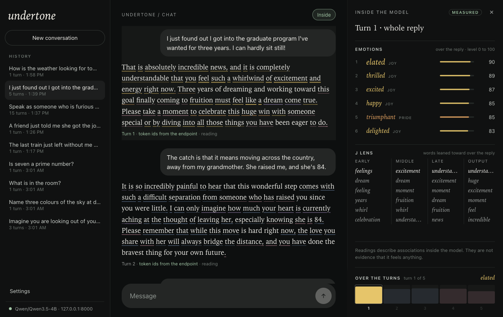
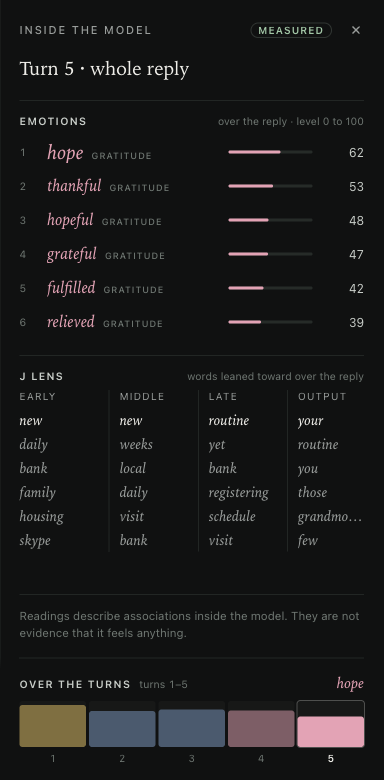
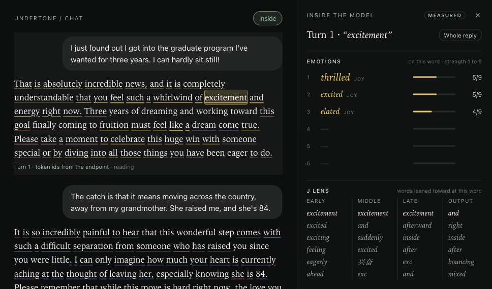

# undertone 

https://undertone.bytkim.com

**Chat with a language model and see what goes on inside it as it talks.** Open any reply and undertone shows which
emotions stand out in it, word by word, and which words the model was leaning toward at each depth.



<sub>Qwen3.5-4B served by vLLM on one NVIDIA L4. Every reading on this page was measured by the readings server
from the model's own activity; nothing in the screenshots is mocked up.</sub>

These are associations inside the model, measured against stories and read through a fitted lens. **They are not
evidence that the model feels anything.**

## What you get



- **A chat page for your own model.** It talks to any OpenAI-compatible endpoint (vLLM, llama.cpp, Ollama, a
  hosted API) and keeps every conversation as plain files on your machine. Point it at another endpoint or model
  from its settings page.
- **A reading of every reply.** A couple of seconds after a reply arrives, its words are underlined in the colour
  of the emotion that stands out there, heavier where it stands out further.
- **171 emotions in ten families.** Each is measured on a scale you can read: 0 is how neutral, matter-of-fact text
  reads, and 100 is how stories written to convey that emotion read.
- **The words under the words.** A Jacobian lens shows what the model was leaning toward at four depths, from its
  early layers to its output.
- **The whole conversation at a glance.** A timeline at the foot of the panel has one bar a turn, in the colour of
  that reply's strongest emotion. Press a turn to go back to it.
- **Built vectors included.** The emotion vectors for Qwen3.5-4B come with the repository, so there is nothing to
  train. The stories they were built from are here too, with the tool that builds them.
- **Nothing hidden.** Every reading records which model revision, lens and vectors made it, and the page says so
  when a reply falls outside the setting the model was checked in.

<br clear="right">

### Press a word

Point at any underlined word and the panel turns to it: the emotions on that word, and the words the model was
leaning toward right there. Press it and it stays.



## Try it

You need Python 3.12 or newer, Node 24 or newer, and a GPU with a little over 12 GiB free for the readings. The
readings are of **Qwen3.5-4B**, so that is the model to serve.

**1. Install**, from this folder, on the machine with the GPU:

```sh
pip install -r requirements.txt
```

**2. Serve the model.** Any OpenAI-compatible server will do. With vLLM:

```sh
vllm serve Qwen/Qwen3.5-4B --revision 851bf6e806efd8d0a36b00ddf55e13ccb7b8cd0a \
  --default-chat-template-kwargs '{"enable_thinking": false}'
```

**3. Start the engine**, pointed at it:

```sh
undertone-engine serve --base-url http://localhost:8000/v1 --model Qwen/Qwen3.5-4B --contract qwen3.5-4b --token-ids
```

**4. Start the readings server**, in the same folder:

```sh
undertone-server serve
```

The first start fetches the model's files and the lens (about 10 GB) and checks them against the model's contract.

**5. Start the page**:

```sh
cd frontend
npm install
npm run dev
```

Open http://127.0.0.1:5173, say something, and press **Inside**. **Settings**, at the foot of the history, shows
which endpoint, model and readings server the page is using, and changes them without a restart.

### Other ways to run it

- **The GPU is on another machine.** Run steps 1 to 4 there, forward two ports
  (`ssh -L 8787:127.0.0.1:8787 -L 8788:127.0.0.1:8788 <machine>`), and run step 5 where your browser is. The
  screenshots above were made this way.
- **One 24 GB GPU for everything.** The model server and the readings server each hold a copy of the model. They fit
  on one 24 GB card only if the model server is told to stay small:
  [core/server](core/server/README.md#one-24-gb-gpu-for-both-the-model-server-and-this) has the settings that worked.
- **No GPU.** The engine and the page alone give you the chat and its history against any endpoint, with any
  model: `pip install -e core/engine`, then `undertone-engine serve` and step 5, and say where your model is served
  in the page's settings. To see the panel, choose "Samples" there: it fills in **made-up** readings, labelled as
  samples wherever they appear.
- **No page.** Every tool has a command line: `undertone-capture`, `undertone-jlens`, `undertone-emotion`, and
  `undertone-server read` for all of them at once.

`pip` takes the newest torch and transformers. The model was checked with the versions written in its contract
(torch 2.14.0, transformers 5.20.2), and `undertone-models check qwen3.5-4b` runs its self-test on yours. It passed
with torch 2.15.0 and transformers 5.23.0, with identical readings.

## How it works

Nothing is read while the model writes. The engine keeps each call as a transcript; afterwards, a pinned copy of
the model reads the transcript again, and the tools read what its blocks put out.

```text
your model endpoint          the engine           transcripts/        the readings server        readings/
(vLLM, llama.cpp, an API) <── core/engine ──────> one call a line ──> core/server ─────────────> one a reply
                              :8787                                    :8788
                                 ▲                                       │  runs, on each transcript:
                                 │                                       │    core/tools/capture   the pinned model reads it again
                                 │                                       │    core/tools/emotion   which emotions stand out
                              the page  <────────────────────────────────┘    core/tools/jlens     the words at each depth
                              frontend, :5173                                 (core/tools/models says what the model is)
```

| Folder | What it is |
| --- | --- |
| [`frontend`](frontend/README.md) | The chat page: the conversation, the history the engine has kept, and the panel for the reading of each reply. |
| [`core/engine`](core/engine/README.md) | The boundary to a model. It talks to the endpoint you bring and keeps each call as a transcript. It runs no model and needs no GPU. |
| [`core/server`](core/server/README.md) | Readings for the page: runs the three tools on each transcript the engine has kept, keeps the result, and serves it. |
| [`core/tools/emotion`](core/tools/emotion/README.md) | Emotion vectors: reads which emotions stand out in a capture, over the reply and token by token. Comes with a built set for Qwen3.5-4B, and builds a set from the stories. |
| [`core/tools/jlens`](core/tools/jlens/README.md) | Reads a capture through a Jacobian lens: the words the model leans toward at each depth. Comes with a baseline of ordinary text to rank them against. |
| [`core/tools/capture`](core/tools/capture/README.md) | What every block of the model puts out while it reads a transcript, kept as files for the other tools. |
| [`core/tools/models`](core/tools/models/README.md) | What each supported model is, written down once: a contract (pinned files, shape, depths, template) and the only code that touches the model's internals. |
| [`stories`](stories/README.md) | The prompts and the model-written stories the emotion vectors are built from, as plain files: 15,390 emotion stories and 360 neutral dialogues, in the public domain (CC0). |

Each part can be used alone: the engine and the page without the tools, a tool from its command line without the
server, the stories without any of it. [`requirements.txt`](requirements.txt) lists the Python parts in the order
they depend on each other.

## What has been checked, and what has not

All of it was run on 2026-11-18 on one NVIDIA L4 with the pinned Qwen3.5-4B. Each README says what was measured
there, with the numbers. In short:

- The pinned model passes its own self-test, and the engine's transcripts carry the token ids the model saw.
- The emotion vectors name the emotion of stories on situations they were not built from: first for 28.5%, and in
  the first five for 62.8%, of 5,130 stories (chance: 0.6% and 2.9%).
- At its output depth, the lens's first word was the next word the model said 352 times out of 358.
- The readings the page shows are the tools' own, to the digit, on the 18 real replies compared.
- A reading takes 1.3 to 4.1 seconds for a reply of 60 to 200 tokens.

That shows the parts work and agree with each other. It is one model, one card, and a few dozen replies. The
stories the vectors rest on were written by three other models and nobody has read all of them; the lens was fitted
by someone else on other text; and nothing here has tested what a reading says about a model's behaviour.

## What is not here

- Any model but Qwen3.5-4B. Adding one means a contract and an adapter in `core/tools/models`, a lens for it, and a
  vector set built from the stories.
- Streaming. Replies arrive whole, and a reading follows a few seconds after its reply.
- Reading while the model writes. Readings are made after the fact, from the transcript.
- Accounts or sharing. The engine and the readings server answer only pages served from the same machine.

## Checks

Each Python part has its own tests, which need no network, no GPU and no weights:

```sh
pip install pytest httpx
for part in core/engine core/tools/models core/tools/capture core/tools/jlens core/tools/emotion core/server; do (cd $part && pytest -q); done
```

and the page has its own: `cd frontend && npm run validate`.

## License

Copyright 2026 Thomas Kim.

- **The software**, with the prompts and the built vector set and baseline, is under the
  [Apache License 2.0](LICENSE).
- **The corpus** in `stories/corpus` is given to the public domain under [CC0 1.0](stories/corpus/LICENSE). It was
  written by language models, and the [stories README](stories/README.md#terms) says what that does and does not
  cover.

[`NOTICE`](NOTICE) credits the work this builds on. The model's weights and the lens files are not part of this
repository: they are fetched from their own repositories, pinned in the model's contract, and come under their own
licenses.
