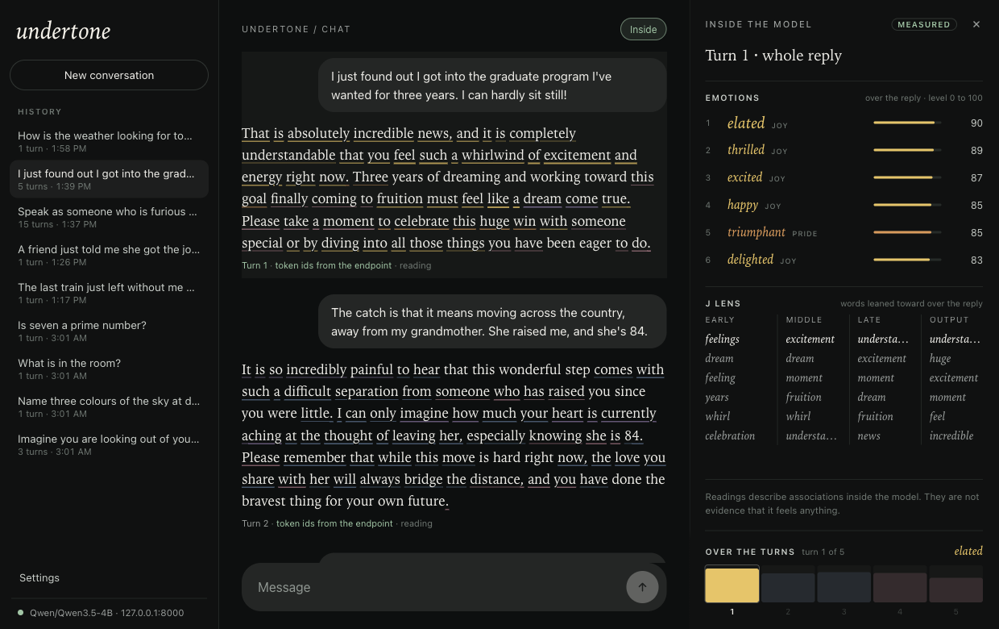
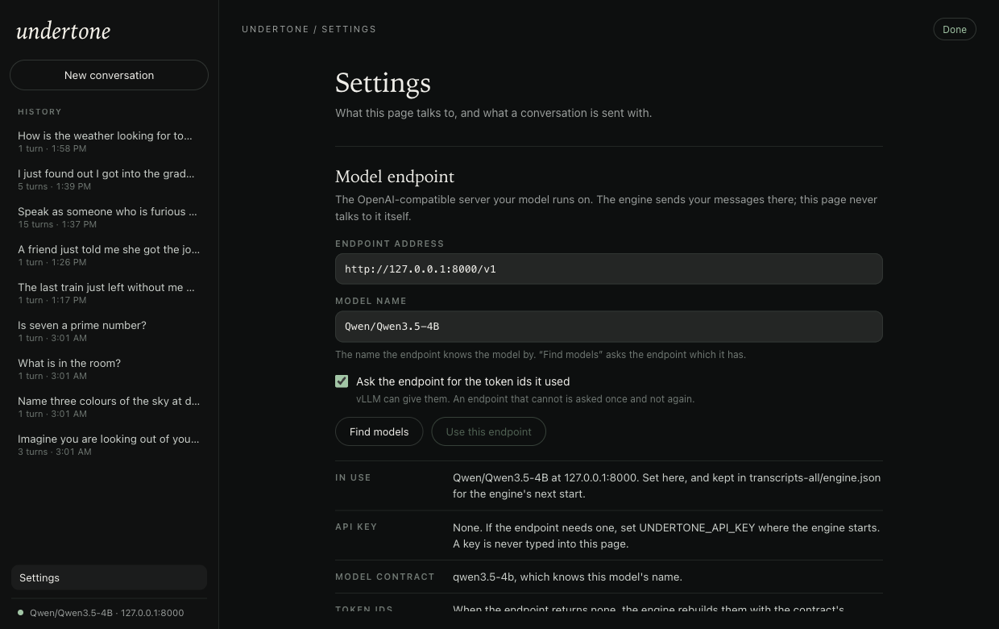

# undertone chat

One page: a conversation in the middle, the conversations kept so far down the left, and a panel that slides out on
the right to show what the tools read inside the model for a reply.



It is a face for two local services and nothing more. A message goes to the [engine](../core/engine/README.md),
which sends it to the endpoint you brought and keeps the call as a transcript; the reply shown is that transcript.
The reading of each reply comes from the [readings server](../core/server/README.md). The page never talks to a
model endpoint itself and never holds a key.

## Start

Requires Node 24 or newer, and the engine installed (`pip install -e core/engine`).

In one terminal, start the engine against your endpoint:

```sh
undertone-engine serve --base-url http://localhost:8000/v1 --model <the model's name on your server>
```

or start it with none (`undertone-engine serve`) and say where your model is served in the page's
[settings](#settings).

In another, start the page:

```sh
cd frontend
npm install
npm run dev
```

Open http://127.0.0.1:5173.

The page looks for the engine at `http://127.0.0.1:8787`. If you serve the engine on another port, change its
address in the settings.

For readings, start the readings server too, on the machine with the GPU (`undertone-server serve`; see
[core/server](../core/server/README.md)). The page looks for it at `http://127.0.0.1:8788`. Without it the page is
still the chat, and the panel says the server is not running.

## What it shows

- **The conversation.** What you said, the reply, and under each reply the turn and where the call's token ids came
  from: the endpoint, rebuilt by the engine, or none. That is what the undertone tools read, so it is worth
  seeing while you chat. A reply's reasoning, when the model gives one, is folded away above it.
- **History.** The engine's own list of transcripts, most recently continued first. A conversation started from the
  command line (`undertone-engine chat`) appears here too, and one started here can be carried on from there.
- **The engine, at the foot of the history:** the model and the endpoint it is talking to, or that it is not running
  (the page then says how to start it).

Enter sends; Shift+Enter makes a new line. If a call fails, the endpoint's error is shown and your words go back in
the box, since nothing was kept.

## Settings

"Settings", at the foot of the history, takes the conversation's place (the address becomes `#settings`, so it can
be reloaded or linked). It has four parts, and each says what is so as well as letting it be changed:



- **Model endpoint.** The address and model name the engine sends your messages to, and whether it asks the
  endpoint for token ids. "Find models" asks the endpoint which models it has; "Use this endpoint" points the
  engine at it, and the engine keeps it for its next start. Under the form the page says where the endpoint in use
  came from, what becomes of the API key, whether the model's contract knows the served name (readings are flagged
  when it does not), and where conversations are kept.
- **New conversations.** A system message, the longest reply in tokens, and a temperature. Each is sent only when
  set; left empty, the endpoint chooses. The system message opens a new conversation only.
- **Readings.** Where they come from (the readings server, made-up samples, or nowhere), the server's address, and
  what that server holds: the model and its revision, how many emotion vectors, which lens, how many readings kept.
- **The engine.** Its address, and whether it is answering.

**A key is never typed into the page.** It stays in the engine's environment (`UNDERTONE_API_KEY`), and the page
only reports whether it is sent to the endpoint in use. The engine holds it back from any endpoint other than the
one it was started with ([core/engine](../core/engine/README.md#the-endpoint-can-be-set-from-the-page)).

The model endpoint is the engine's setting, so every page and the command line agree on it. Everything else is the
page's own: it is kept in this browser (`localStorage`), takes effect as it is changed, and "Back to defaults" lets
it go.

## Inside the model

A reply that has a **reading** has its words marked: a word where an emotion stands out is underlined in that
emotion's family colour, heavier the further it stands out. (The marks are on the model's tokens; the tokens of
one word are kept together on a line.) "Inside", at the top right, slides a panel out beside
the conversation (the conversation narrows; it is not covered). So does pressing a turn, or a marked word. Escape,
or the cross at its corner, puts it away.

**Every turn can be pressed** (anywhere on it, or "Turn n" under it). The panel then shows that turn's reply, and
the turn is marked in the conversation.

The panel has one layout and two scopes:

- **The whole reply:** the emotions that stand out most, each with its level, and the J lens: the four depths side
  by side (early, middle, late, output), each with the words the model leans toward there listed down its column,
  the most leaned-toward first (six a depth). A level runs from 0 to 100: 0 is how neutral, matter-of-fact text
  reads on that emotion, and 100 is how stories written to convey it read.
- **One word:** point at a marked word and the panel turns to it for as long as you stay on it: the emotions on that
  word (strength 1 to 9) and the words at each depth there. Press the word and it stays; "Whole reply" lets go.

The rows are the same rows in both, so moving between a word and the reply never shifts the page. Under about
1000px of width the panel slides over the conversation instead of beside it.

**Over the turns** stands at the panel's foot, always in view: the conversation as a timeline, one column a turn.
Each column is a bar in the colour of that reply's strongest emotion, as tall as that emotion stands out; the turn
the panel is showing is lit and named. The timeline reads **up to the turn on show**: the turns after it stand back,
faint, and its heading says so ("turns 1–3 of 7"). Press a turn, here or in the conversation, to show that reply;
a turn that stands back can be pressed to move on to it. A turn with no reading keeps its place, empty.

A reading takes a few seconds to make the first time a reply is shown, and the panel says "Reading this reply…"
until it arrives. If the reply lies outside the setting the model was checked in (thinking was on, say, or the
endpoint served another model), the reading is still shown, with a line saying so and in what way.

### Where readings come from

The page does not know how a reading is made. `src/readings.ts` holds the contract (`Reading`: the reply as a whole,
then piece by piece, the pieces joining back into the reply exactly) and a `ReadingSource`, which answers one
question: the reading of this transcript, or none. Three exist, chosen in the settings:

| Readings come from | Source |
| --- | --- |
| The readings server (the default) | `GET {its address}/readings/{transcript id}` answers a `Reading`. The address is `http://127.0.0.1:8788` unless changed. |
| Samples | Readings **made up** from the reply's own words, to look at the page without a GPU. |
| Nowhere | None: the page is the plain chat, with no panel. |

What the page starts with, before anything is changed in the settings, can be set when it is built or started:
`VITE_ENGINE_URL` for the engine's address, and `VITE_READINGS` (an address, `sample` or `off`) for the readings.

A reading that is not in the contract's shape counts as none. A reading whose pieces do not join back into the reply
exactly is still shown in the panel, but the reply keeps the transcript's own words, unmarked: the page never shows
text the transcript does not have. When the readings server cannot be reached at all, the panel says so, with the
command that starts it and a button to ask again.

**Sample readings are not measurements.** Nothing in them comes from a model. Each says so (`sample: true`), the
panel carries a "Sample" tag and a line saying so, and the line under each reply reads "sample reading". Measured
readings carry the tag "measured".

## What is not here yet

- Replies arrive whole (the engine does not stream yet) and are shown as plain text, not rendered Markdown.
- Settings are for the page as a whole: a conversation cannot have a system message or a temperature of its own,
  and other sampling settings (top-p, a seed, stop words) are not offered.
- The model's contract and the tokenizer are chosen when the engine starts, and the readings server's model, lens
  and vectors when it starts. The settings show them and cannot change them.
- A reading shows the top of what the tools found: six emotions and six words a depth. The rest is in the reading's
  file and in the tools' own output.

## Files

- `src/engine.ts`: the page's connection to the engine and its requests.
- `src/app.tsx`: the page.
- `src/settings.ts`: the page's own settings, kept in this browser.
- `src/settingspage.tsx`: the settings page.
- `src/readings.ts`: the readings contract, the boundary they arrive through, and the sample source.
- `src/inside.tsx`: a reply's marked words, and the Inside panel.
- `src/families.ts`: the ten emotion families' colours and short names.
- `src/styles.css`: undertone's look.

## Checks

```sh
npm run validate   # types, tests, build
```

The tests use an engine and readings in memory: nothing needs to be running.
